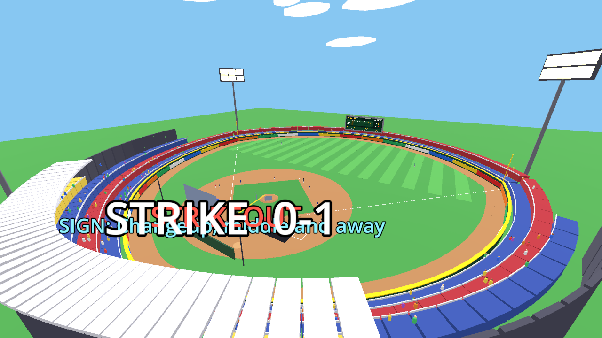
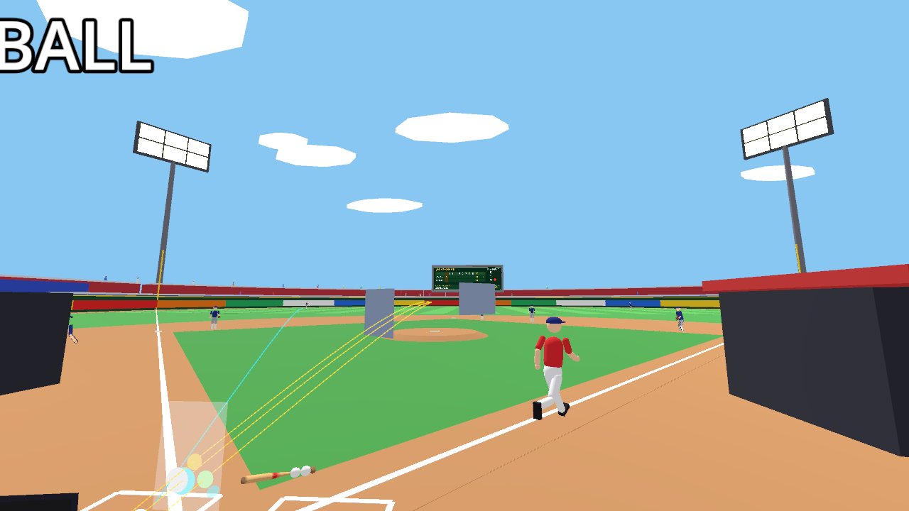

# VR Baseball

A pitching-first baseball game for Meta Quest 3. You throw the ball with your own arm: the way you
move the controller decides the speed, the spin, and which pitch comes out. Built with Godot 4.7
(OpenXR, mobile renderer). Fictional league, cartoony low-poly art.



> **Status: playable on desktop, not yet tried in a headset.** Everything is developed and tested with
> `--xr-mode off`. Tuning numbers are first guesses until a real playtest. See
> [docs/PLAYTEST.md](docs/PLAYTEST.md) and [ROADMAP.md](ROADMAP.md).

## What is in it

- **Pitching by technique.** No pitch menu. A wrist snap, a twist, a lower arm slot or a slow throw
  each produce a curveball, slider, sinker or changeup, judged against *your* usual throw.
  Ball flight is a custom integrator (gravity, drag, Magnus), not engine physics.
- **A full game.** Counts, innings, baserunning, steals, pickoffs, wild pitches, umpire calls, an
  inning card between halves, and a ghost replay of big hits.
- **Every position.** Switch roles to bat, catch (framing and blocking), pitch, cover first base, or
  field. The AI plays the other side.
- **Modes.** Pure, Assisted and Career, with separate leaderboards. Career has a fictional league
  with home parks and rosters, and you learn new pitches by throwing them.
- **Extras.** Pitch lab, drills, home run derby, a daily game, parks with their own walls and wind,
  a crowd, dugouts, and accessibility options.
- **Quest budgets.** `tools/perf.sh` gates draw calls, triangles and labels (currently about 85 draw
  calls on average against a limit of 220).



## Run it

You need [Godot 4.7](https://godotengine.org/) on your `PATH` or configured in `tools/godot.sh`.

```bash
tools/godot.sh --xr-mode off          # desktop, no headset
tools/godot.sh --xr-mode off -- --demo  # AI plays itself, handy for a look
```

With a headset, run over Virtual Desktop or Quest Link and leave XR on.

## Test and measure

```bash
tools/test.sh                         # all 68 headless test scripts in tests/
tools/perf.sh --demo --budget         # draw-call / triangle budget gate
tools/perf.sh --demo --quest-budget   # stricter, provisional Quest gate
tools/shot.sh overview --demo         # render screenshots to tools/shots/
```

Gameplay rules live in small pure-logic classes (`scripts/`), each with a headless test. The main
scene `bullpen.gd` is a composition root wired through a typed event bus (`game_bus.gd`).

## Docs

| File | What it covers |
| --- | --- |
| [DESIGN.md](DESIGN.md) | How each system works and what the recorded throws taught us |
| [ROADMAP.md](ROADMAP.md) | Where the game stands and what is next |
| [docs/PLAYTEST.md](docs/PLAYTEST.md) | Headset checklist and every first-guess tuning value |
| [docs/QUEST.md](docs/QUEST.md) | Standalone Quest export checklist (written, not yet run) |
| [docs/PERFORMANCE.md](docs/PERFORMANCE.md) | Measured frame and draw-call numbers |
| [docs/AUDIO.md](docs/AUDIO.md), [docs/AUDIO_LIST.md](docs/AUDIO_LIST.md) | Sound design and the list of recordings still needed |
| [docs/ANIMATION.md](docs/ANIMATION.md) | Character animation notes |

## Not done yet

Standalone Quest build and on-device measurement, headset tuning, real audio recordings, character
models, and online score sharing. Details in [ROADMAP.md](ROADMAP.md).
